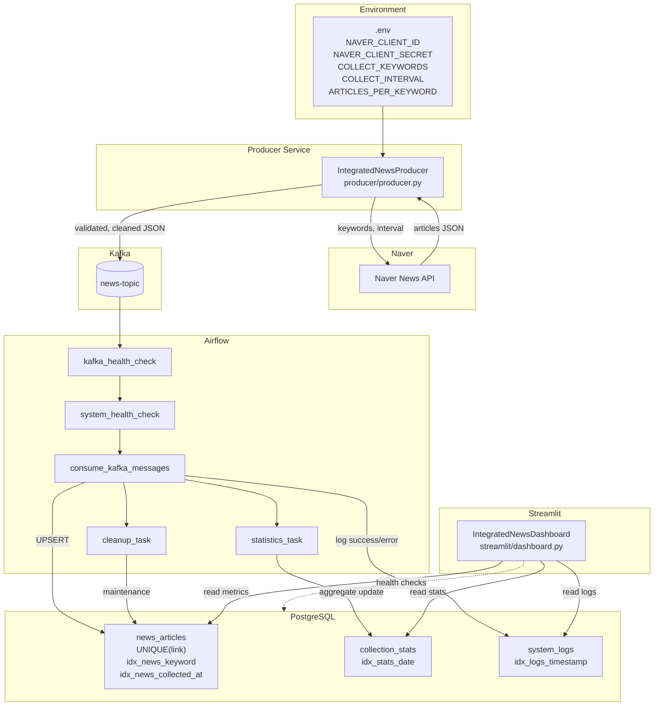
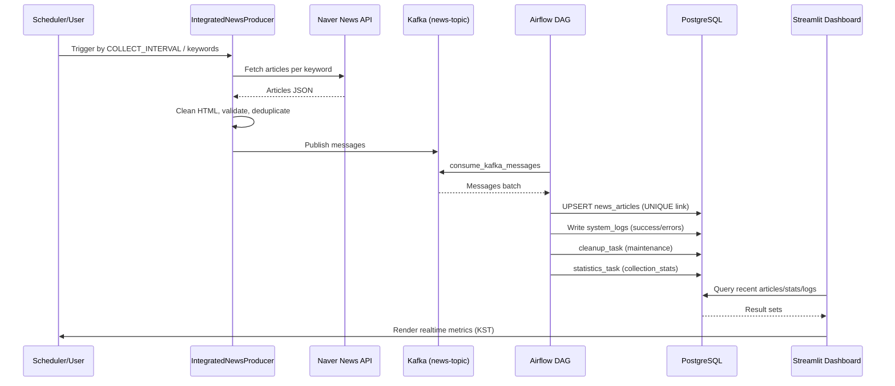
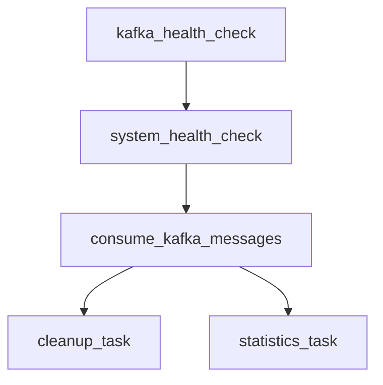

# System Diagrams (NewsDeck)

본 문서는 프로젝트의 주요 흐름을 Mermaid 다이어그램으로 정리합니다. 각 섹션에는 간략한 설명과 함께 상위 아키텍처, 수집-처리-시각화 시퀀스, Airflow DAG 의존성, 데이터 모델(개념적)을 포함합니다.

## 1) 상위 아키텍처 (End-to-End 흐름)

- 입력: Naver News API, 환경 변수(.env)
- 처리: Producer → Kafka → Airflow ETL → PostgreSQL
- 출력: Streamlit Dashboard(실시간 지표/시각화), 시스템 로그

## 2) 수집-처리-시각화 시퀀스

- 스케줄/사용자 트리거에 따라 Producer가 키워드별 기사 수집
- Kafka로 발행된 메시지를 Airflow가 소비하여 DB에 적재/집계/정리
- Streamlit이 DB에서 최신 지표를 조회해 실시간 대시보드 제공

## 3) Airflow DAG 의존성

- 사전 점검(카프카/시스템) 후 메시지 소비 → 정리/집계 분기
- 오류/중복은 DB 제약과 로깅으로 관리

